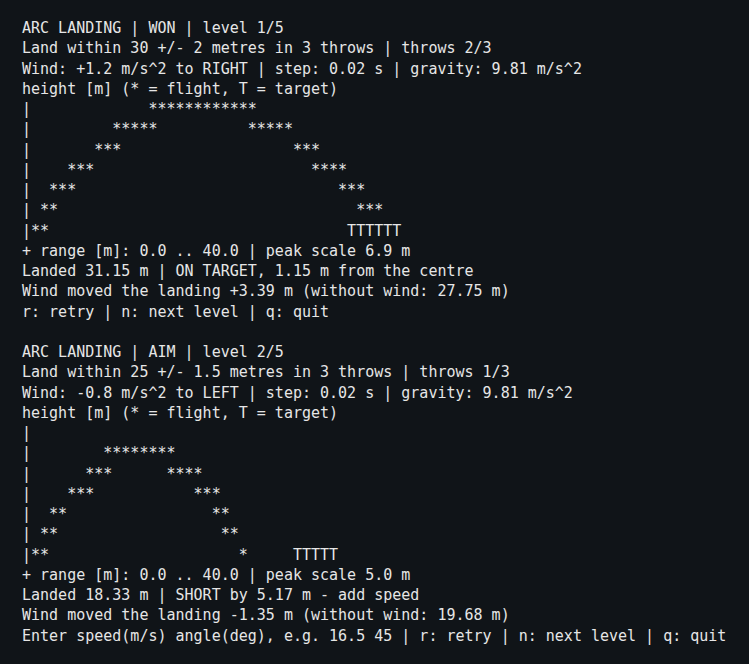

# Arc Landing

Choose speed and angle to land on the target in at most three throws. Enter two numbers such as **16.5 45**. The result says by how many metres you landed short or long, how far the wind moved the landing, and draws an ASCII trajectory. There are five levels: the first is **30 ± 2 metres** with a wind to the right, the other four are placed by a fixed seed (the same on every machine) with their own target and wind. **r** retries the level from scratch, **n** goes to the next level, **q** or EOF exits; invalid input consumes no throw.

Wind is a constant horizontal acceleration, **+1.2 m/s²** to the right on level 1 and between −1.8 and +0.9 m/s² on the others. Julia integrates motion with fixed-step velocity Verlet (at most 0.02 seconds per step) and interpolates the ground crossing. Gravity is 9.81 m/s², without drag. The exact no-wind equations remain as `flight` for comparison; `trajectory` accepts wind and step size for experiments. This is an aiming model, not a weather simulation.



The last two screens of the real CLI demo (`make demo`) on 2026-11-11: level 1 won, then a short throw on level 2. Its stdout is in [docs/images/screen.txt](docs/images/screen.txt) and is rendered in a monospace viewer for the image. The game runs in a terminal.

**Theory handbook**: [docs/theory/](docs/theory/README.md) — 9 statements (projectile motion, the wind as a constant acceleration, why the step is exact, the interpolated landing and its error, the shortened step, the target and turns, input validation, the character plot, the five seeded levels with retry and next), each with its equation, assumptions, derivation, code, tests and a figure. `make theory-figs` regenerates the figures and the measured values; `make theory-check` checks the coverage table.

## Install and play

Linux x86-64, no sudo or containers. Install the current stable runtime as checked on 2026-11-06 ([Julia manual downloads](https://julialang.org/downloads/manual-downloads/)).

```sh
curl -fLO https://julialang-s3.julialang.org/bin/linux/x64/1.13/julia-1.13.3-linux-x86_64.tar.gz
curl -fLO https://julialang-s3.julialang.org/bin/checksums/julia-1.13.3.sha256
awk '$2 == "julia-1.13.3-linux-x86_64.tar.gz"' julia-1.13.3.sha256 | sha256sum -c -
mkdir -p "$HOME/.local"
tar xzf julia-1.13.3-linux-x86_64.tar.gz -C "$HOME/.local"
export PATH="$HOME/.local/julia-1.13.3/bin:$PATH"
julia --project=. --startup-file=no -e 'using Pkg; Pkg.instantiate()'
```

Python 3.14 is required by the local report adapter. From this repository:

```sh
make play
make demo
make test
make check
```

`test` runs native unit tests; `check` also drives a real CLI victory. JUnit XML and schema-versioned summary JSON go to ignored `test-results/`. No test contacts a live service. PR CI runs unit checks only.

M3 is implemented: five fixed-seed levels, the reason for a miss, retry and next. Terminal accessibility, Windows and macOS execution, long sessions and player enjoyment are unverified.

Verified on Linux: 381 native Test results + 1 CLI smoke, all passing. See [requirements](docs/requirements.md).
