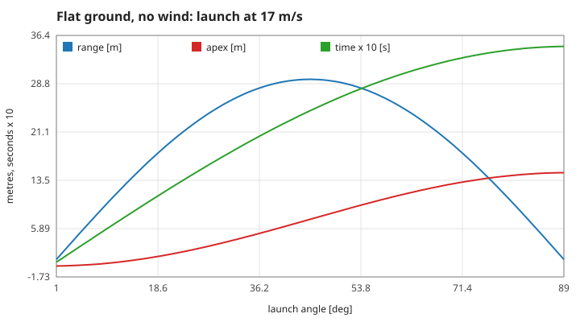
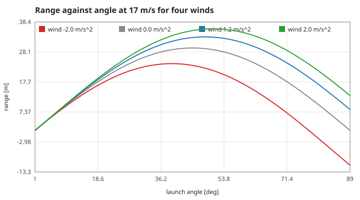
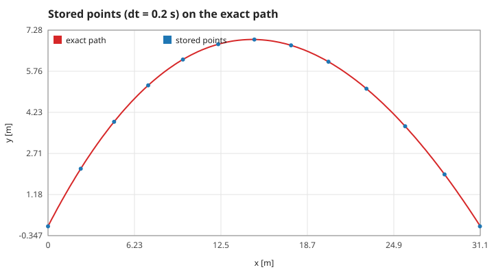
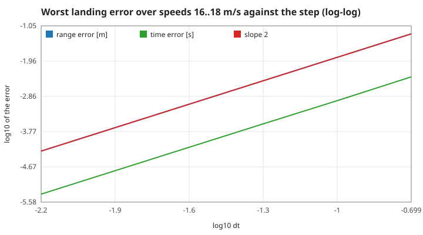
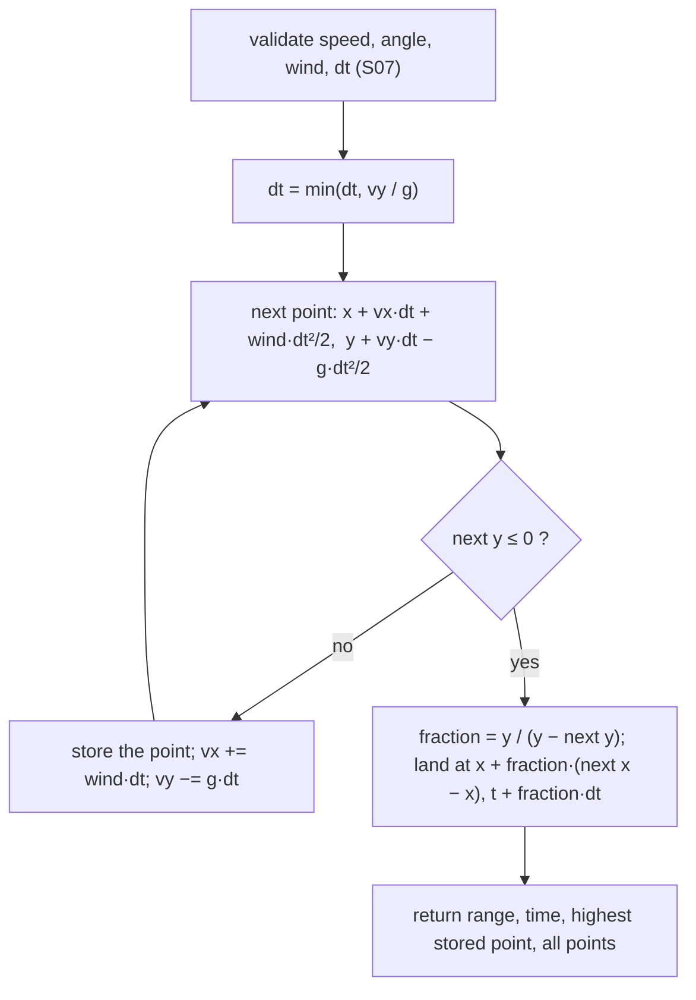

# 1. The throw: projectile motion and how it is computed

SI units: metres, seconds, degrees for the launch angle; standard gravity $g = 9.81$ m/s². Measured numbers are quoted by their id in [figures/values.md](figures/values.md).

[Back to the index](README.md)

## S01 — Projectile motion on flat ground

**Statement.** A point thrown from the ground at speed $v$ and angle $\theta$ above the horizontal, with no air resistance, moves as $x = v\cos\theta\,t$, $y = v\sin\theta\,t - \tfrac12 gt^2$ and lands after

$$T = \frac{2v\sin\theta}{g}, \qquad R = \frac{v^2\sin 2\theta}{g}, \qquad H = \frac{v^2\sin^2\theta}{2g}$$

(time of flight, range, apex) [Galilei 1638, Fourth Day; Halliday, Resnick & Walker 2014, §4.4]. The range is the same for an angle $\theta$ and its complement (90° minus $\theta$), and largest at 45°.

**Assumptions and where they break.** A point mass, uniform gravity, flat ground at the launch height, vacuum. For a real ball at 17 m/s drag shortens the range noticeably; the game's "wind" (S02) is not drag.

**Derivation.** Constant acceleration $(0, -g)$ integrated twice; $y = 0$ at $t = T$; $R = v\cos\theta\,T$; the apex is at $T/2$.

**Code.** `flight` in `src/ArcLanding.jl` (returns `range`, `time`, `height`).

**Tests.** `REQ-flight analytic range` in `test/runtests.jl`: range and apex at 10 m/s, 45°, and the equality of the 30° and 60° ranges. Measured: `range-10-45` = 10.19 m, `apex-10-45` = 2.548 m, `time-10-45` = 1.442 s, `complementary` = 1, `best-angle` = 45.

## S02 — A constant sideways push: the game's wind

**Statement.** The "wind" is a constant horizontal acceleration $a$ (the game uses +1.2 m/s², to the right). The vertical motion, and so the time of flight $T$, is unchanged; the landing point moves by

$$\Delta R = \tfrac12 a T^2, \qquad R_a = \frac{v^2\sin2\theta}{g} + \frac{2av^2\sin^2\theta}{g^2}.$$

The best angle is no longer 45°: $\theta^* = 45° + \tfrac12\arctan(a/g)$, 48.5° for the game's wind.

**Assumptions and where they break.** A real wind exerts a drag that depends on the relative velocity; this is the simplest stand-in, a uniform force field — the problem is that of projectile motion with gravity tilted by $\arctan(a/g)$. The code accepts $|a| \le 3$.

**Derivation.** $x = v\cos\theta\,t + \tfrac12 at^2$ at $t = T$. Setting $dR_a/d\theta = 0$ gives $\tan2\theta^* = -g/a$.

**Code.** `trajectory` in `src/ArcLanding.jl` (keyword `wind`, default 1.2).

**Tests.** `REQ-wind numeric integration and convergence`: for winds −2, 0, 2 the range approaches $R + \tfrac12aT^2$ as the step shrinks, and a tailwind carries further than a headwind. Measured with a step of 0.001 s: `wind-shift-1.2` = 3.6036 m, `wind-shift-2.0`, `wind-shift--2.0` (all to 3 parts in 100 million); `time-unchanged` = 1; the best whole-degree angle is `best-angle-wind` = 48.

## S03 — The step: exact for a constant acceleration

**Statement.** Each step of length $\Delta t$ advances

$$x \mathrel{+}= v_x\Delta t + \tfrac12a\Delta t^2, \quad y \mathrel{+}= v_y\Delta t - \tfrac12g\Delta t^2, \qquad v_x \mathrel{+}= a\Delta t, \quad v_y \mathrel{-}= g\Delta t .$$

This is the velocity Verlet update [Swope et al. 1982]; because the acceleration here is constant, it is not an approximation: every stored point lies exactly on the true path, whatever the step.

**Assumptions and where they break.** Constant acceleration. With a force that depended on position or velocity (drag), the same update would be second-order accurate, not exact. The reported apex is the highest stored point, so it can be slightly below the true apex.

**Derivation.** The Taylor series of the position ends at the second-order term when the acceleration is constant.

**Code.** The loop of `trajectory` in `src/ArcLanding.jl`.

**Tests.** `REQ-wind numeric integration and convergence` (apex within 0.001 m, range within 0.04 m of S01 at the default step). Measured with a step ten times the game's: stored points are within `points-on-path` = 7e-15 m of the exact positions; the sampled apex is `apex-sampled` = 0.99992 of the true one.

## S04 — Landing: a straight line across the last step

**Statement.** The first step that would end below the ground is cut short by linear interpolation: with heights $y > 0$ before and $y' \le 0$ after, the fraction $f = y/(y - y')$ of the step is taken for both $x$ and $t$. Replacing the last arc of the parabola by its chord makes the landing slightly early, by an error proportional to $\Delta t^2$:

$$|\delta t| \le \frac{g\,\Delta t^2}{8\,|v_y^{land}|}, \qquad |\delta R| \approx v_x^{land}\,|\delta t| .$$

**Assumptions and where they break.** The bound needs the landing not to be grazing ($v_y^{land}$ not tiny); the allowed angles start at 1°. The error depends on where inside a step the ground is crossed, so it is not a smooth function of the speed — the figure takes the worst case over a range of speeds.

**Derivation.** A parabola with second derivative $g$ lies above its chord by at most $g\Delta t^2/8$ (at the middle of the step). The chord therefore reaches $y = 0$ earlier than the parabola by at most that height divided by the descent rate.

**Code.** The `if ny <= 0` branch of `trajectory` in `src/ArcLanding.jl`.

**Tests.** `REQ-wind numeric integration and convergence`: errors decrease from step 0.2 to 0.1 to 0.05 and are below 0.01 m at 0.05. Measured: order `landing-order` = 2.0006; at the game's step 0.02 s the worst range error is `landing-error-game` = 0.55 mm, under the bound `landing-bound-game` = 0.61 mm; the demonstration throw lands at `landing-demo` = 31.1469 m against 31.1471 m, and early (`landing-early` = −1).

## S05 — A step never longer than the climb

**Statement.** Before the loop the step is shortened to $\min(\Delta t, v_y/g)$, the time to the apex. The first step can then never end below the ground, so every throw has at least one point in the air and the interpolation of S04 always has a positive height to start from.

**Assumptions and where they break.** Allowed inputs only ($v \ge 1$, $\theta \ge 1°$, so $v_y > 0$). For a very shallow throw the step becomes the time to the apex itself and the flight is exactly two steps.

**Derivation.** After one step of $\Delta t \le v_y/g$ the height is $v_y\Delta t - \tfrac12g\Delta t^2 \ge \tfrac12 v_y\Delta t > 0$.

**Code.** `dt = min(dt, vy / 9.81)` in `trajectory`, `src/ArcLanding.jl`.

**Tests.** `REQ-input trajectory bounds and target boundaries`: the steepest, fastest throw ends exactly on the ground with no point below it. Measured: 1 m/s at 1° asked with a step of 0.2 s stores `shallow-points` = 3 points and still gives the exact range and apex (`shallow-range`, `shallow-apex`); `steep-ground` = 0, `steep-above` = 0.

## References

- G. Galilei, *Discorsi e dimostrazioni matematiche intorno a due nuove scienze*, 1638.
- D. Halliday, R. Resnick, J. Walker, *Fundamentals of Physics*, 10th ed., Wiley, 2014.
- W. C. Swope, H. C. Andersen, P. H. Berens, K. R. Wilson, *J. Chem. Phys.* 76, 637 (1982) — the velocity form of Verlet's method.
