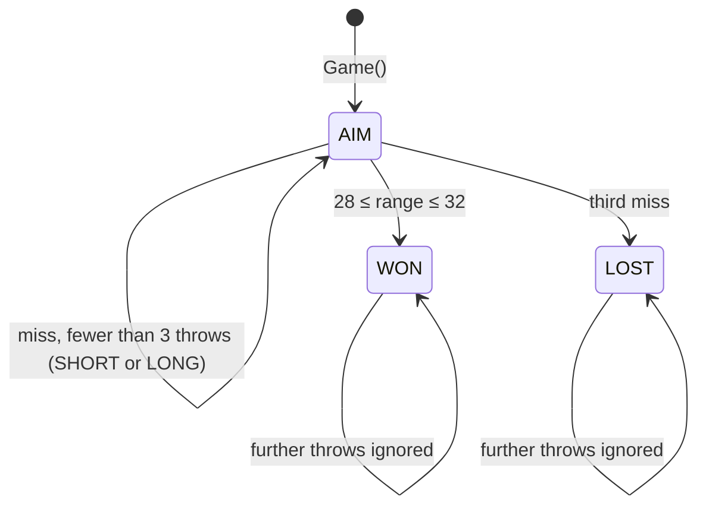
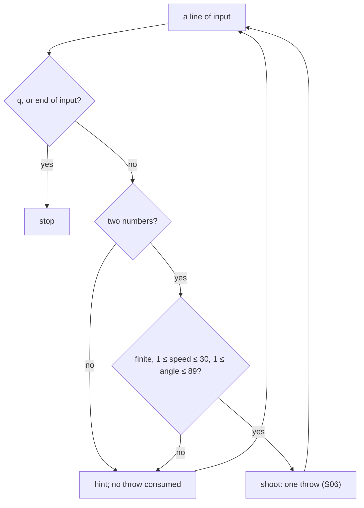
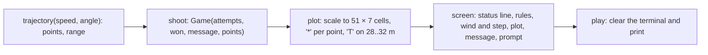

# 2. The game: target, turns, input and the screen

The rules built on the throw of page 1. Measured numbers are quoted by their id in [figures/values.md](figures/values.md).

[Back to the index](README.md)

## S06 — The target and the three throws

**Statement.** A throw **hits** when its range $R$ (computed as in S02–S04, wind +1.2 m/s², step 0.02 s) lies in the closed interval $R \in [28, 32]$ m, both ends included. A game is at most three throws; the first hit wins and freezes the game, three misses lose it. After each miss the message says SHORT ($R < 28$) or LONG.

**Assumptions and where they break.** The interval is closed, and a range that is not a number is a miss. The range is the game's numerical one, so within a millimetre of an edge the outcome follows S04's error, not the closed form.

**Derivation.** A design rule. At 45° the window is about 1 m/s wide: the wind adds 3.4 m to a 28 m throw, so the no-wind estimate $v = \sqrt{30g} = 17.2$ m/s overshoots.

**Code.** `hit`, `shoot` and the `Game` struct in `src/ArcLanding.jl`.

**Tests.** `REQ-finish win, miss, freeze and input recovery` and the boundary checks of `REQ-input trajectory bounds and target boundaries` in `test/runtests.jl`. Measured: `hit-28` = 1, `hit-32` = 1, `hit-just-outside` = 0; at 45° the hitting speeds on a 0.05 grid run from `hit-speed-low` = 15.65 to `hit-speed-high` = 16.70 m/s; `game-won` = 1, `game-frozen` = 1, `game-three` = 3.

## S07 — What input is accepted

**Statement.** A throw needs two finite numbers: speed in $[1, 30]$ m/s and angle in $[1, 89]$ degrees. The integrator additionally requires $|{\rm wind}| \le 3$ m/s² and a step in $[0.001, 0.2]$ s. Anything else raises an `ArgumentError`; at the prompt it prints a hint and **does not consume a throw**. End of input ends the game safely.

**Assumptions and where they break.** The limits keep $v_y > 0$ (S05) and the flight inside the plotted area's rescaling (S08); they are not physical limits.

**Derivation.** A design rule.

**Code.** `parameters`, the bounds check in `trajectory`, and `play` in `src/ArcLanding.jl`.

**Tests.** `REQ-input finite bounded parameters` and `REQ-input trajectory bounds and target boundaries`. Measured: of ten out-of-range calls `input-rejected` = 10 raise; of four calls on the edges `input-accepted` = 0 are rejected; three invalid lines and one valid throw consume `input-no-throw` = 1 throw; an empty input consumes `input-eof` = 0.

## S08 — The picture is drawn from the measured points

**Statement.** The screen shows the stored points of the last flight (S03) on a grid of 51 columns by 7 rows. The horizontal scale runs from $\min(0, x_{min})$ to $\max(40, x_{max})$ and the vertical from 0 to $\max(5, y_{max})$; each point goes to the nearest cell. The target is marked on the bottom row from 28 to 32 m. The scales used are printed under the plot.

**Assumptions and where they break.** A cell is 0.8 m wide by default, so the plot shows the shape of the flight, not whether a throw near the edge of the target hit; the message line gives the range to a centimetre.

**Derivation.** A design rule: nothing on screen is drawn from the closed form — only from what the integrator produced.

**Code.** `plot`, `screen` and `play` in `src/ArcLanding.jl`.

**Tests.** `REQ-input trajectory bounds and target boundaries` checks that the screen names the wind and contains flight and target marks; `make check` plays a real game through the command line to WON. Measured: `screen-rows` = 7, `screen-width` = 51, `screen-target` = 6 columns of T, and the demonstration flight fills `screen-stars` = 39 columns.

## References

- The rules are this repository's: `src/ArcLanding.jl`, `docs/requirements.md`.
