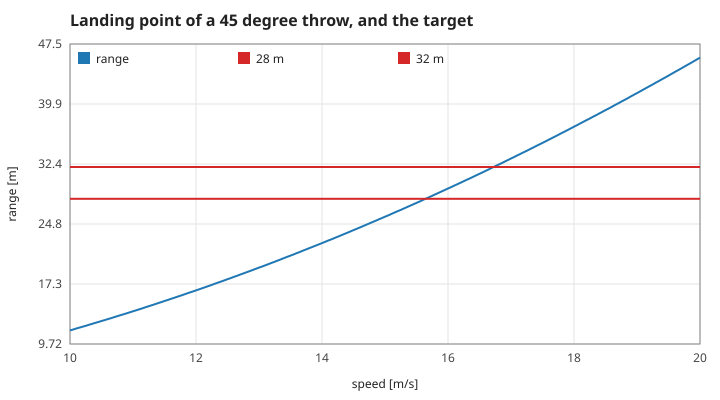
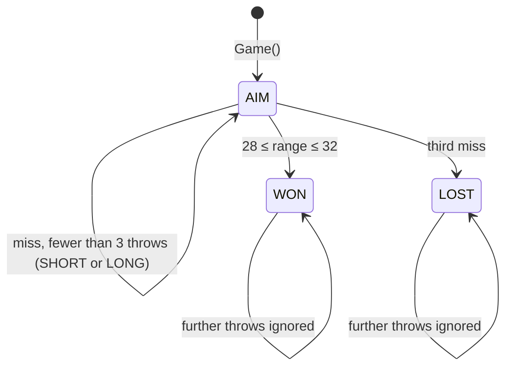
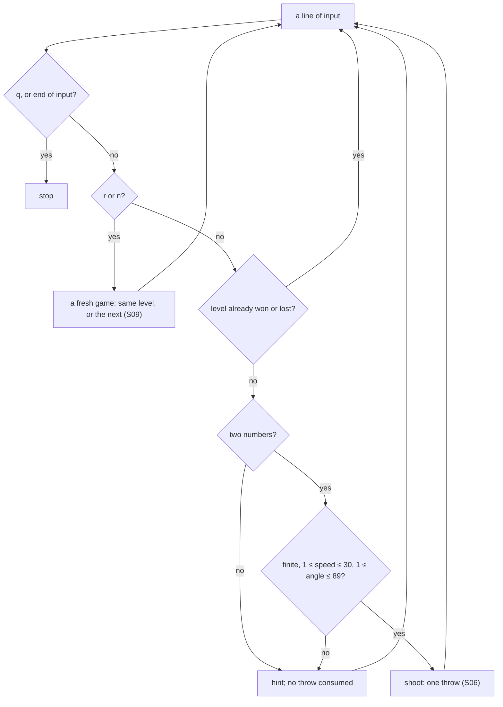
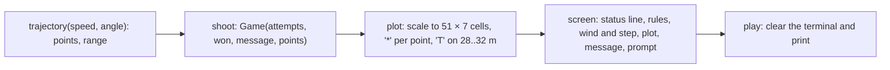
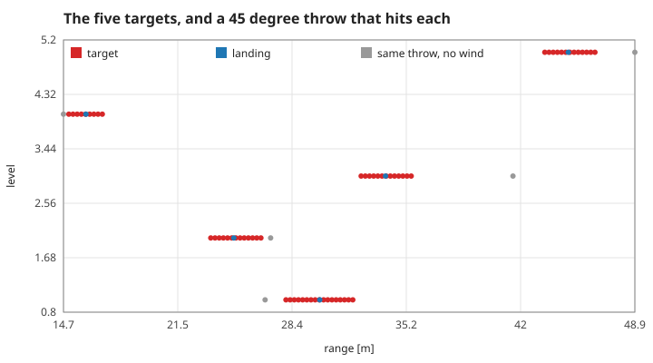
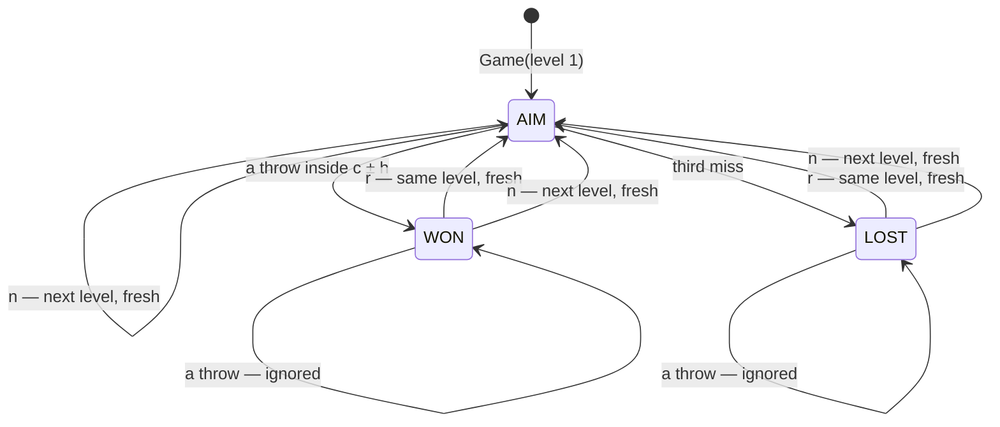

# 2. The game: target, turns, input, the screen and the levels

The rules built on the throw of page 1. Measured numbers are quoted by their id in [figures/values.md](figures/values.md).

[Back to the index](README.md)

## S06 — The target and the three throws

**Statement.** A throw **hits** when its range $R$ (computed as in S02–S04, step 0.02 s) lies in the closed interval $[c - h,\ c + h]$ of the level being played, both ends included; on level 1 that is $R \in [28, 32]$ m with wind +1.2 m/s² (the other levels are in S09). A game is at most three throws; the first hit wins and freezes the game, three misses lose it. After each miss the message says SHORT or LONG and by how many metres, measured to the nearer edge of the target, and every message names the wind's share: the range with the level's wind minus the range of the same throw without wind.

**Assumptions and where they break.** The interval is closed, and a range that is not a number is a miss. The range is the game's numerical one, so within a millimetre of an edge the outcome follows S04's error, not the closed form.

**Derivation.** A design rule. At 45° the window is about 1 m/s wide: the wind adds 3.4 m to a 28 m throw, so the no-wind estimate $v = \sqrt{30g} = 17.2$ m/s overshoots.

**Code.** `hit`, `shoot`, `reason`, `finished` and the `Game` struct in `src/ArcLanding.jl`.

**Tests.** `REQ-finish win, miss, freeze and input recovery` and the boundary checks of `REQ-input trajectory bounds and target boundaries` in `test/runtests.jl`. Measured: `hit-28` = 1, `hit-32` = 1, `hit-just-outside` = 0; at 45° the hitting speeds on a 0.05 grid run from `hit-speed-low` = 15.65 to `hit-speed-high` = 16.70 m/s; `game-won` = 1, `game-frozen` = 1, `game-three` = 3. The reason line is checked by `REQ-reason why a throw missed, and the wind's share`; for the demonstration throw `reason-wind` = 3.39 m and `reason-shown` = 1.

## S07 — What input is accepted

**Statement.** A throw needs two finite numbers: speed in $[1, 30]$ m/s and angle in $[1, 89]$ degrees. The integrator additionally requires $|{\rm wind}| \le 3$ m/s² and a step in $[0.001, 0.2]$ s. Anything else raises an `ArgumentError`; at the prompt it prints a hint and **does not consume a throw**. End of input ends the game safely.

**Assumptions and where they break.** The limits keep $v_y > 0$ (S05) and the flight inside the plotted area's rescaling (S08); they are not physical limits.

**Derivation.** A design rule.

**Code.** `parameters`, the bounds check in `trajectory`, and `play` in `src/ArcLanding.jl`.

**Tests.** `REQ-input finite bounded parameters` and `REQ-input trajectory bounds and target boundaries`. Measured: of ten out-of-range calls `input-rejected` = 10 raise; of four calls on the edges `input-accepted` = 0 are rejected; three invalid lines and one valid throw consume `input-no-throw` = 1 throw; an empty input consumes `input-eof` = 0.

## S08 — The picture is drawn from the measured points

**Statement.** The screen shows the stored points of the last flight (S03) on a grid of 51 columns by 7 rows. The horizontal scale runs from $\min(0, x_{min})$ to $\max(40,\ c + h + 4,\ x_{max})$ and the vertical from 0 to $\max(5, y_{max})$; each point goes to the nearest cell. The target is marked on the bottom row across the level's interval (28 to 32 m on level 1), and the horizontal scale always reaches 4 m beyond it. The scales used are printed under the plot.

**Assumptions and where they break.** A cell is 0.8 m wide by default, so the plot shows the shape of the flight, not whether a throw near the edge of the target hit; the message line gives the range to a centimetre.

**Derivation.** A design rule: nothing on screen is drawn from the closed form — only from what the integrator produced.

**Code.** `plot`, `screen` and `play` in `src/ArcLanding.jl`.

**Tests.** `REQ-input trajectory bounds and target boundaries` checks that the screen names the wind and contains flight and target marks; `make check` plays a real game through the command line to WON. Measured: `screen-rows` = 7, `screen-width` = 51, `screen-target` = 6 columns of T, and the demonstration flight fills `screen-stars` = 39 columns.

## S09 — Five placements from a fixed seed; retry and next start clean

**Statement.** A level is a target centre $c$, a half-width $h$ and a wind $w$. There are five. Level 1 is fixed ($c = 30$ m, $h = 2$ m, $w = +1.2$ m/s²). Levels 2 to 5 are drawn from a seed by a fixed integer recurrence, three draws $u_1, u_2, u_3$ per level:

$$c = 12 + (u_1 \bmod 37)\ \text{m}, \qquad h = 1 + \tfrac12 (u_2 \bmod 3)\ \text{m}, \qquad w = \frac{(u_3 \bmod 41) - 20}{10}\ \text{m/s}^2 ,$$

so $c$ lies between 12 and 48 m, $h \in \{1, 1.5, 2\}$ and $|w| \le 2$. The same seed gives the same five levels on every machine. Every level can be hit with a speed and an angle inside the accepted input (S07).

**r** starts the same level again and **n** starts the following one (after the fifth comes the first). Either gives a game that is equal, field by field, to one never played: no throws counted, no flight drawn, the opening message. A level that is won or lost accepts only r, n and q.

| Level | Centre $c$ [m] | Half-width $h$ [m] | Wind $w$ [m/s²] |
|---|---|---|---|
| 1 | 30 | 2 | +1.2 |
| 2 | 25 | 1.5 | −0.8 |
| 3 | 34 | 1.5 | −1.8 |
| 4 | 16 | 1 | +0.9 |
| 5 | 45 | 1.5 | −0.8 |

**Assumptions and where they break.** The draws use splitmix64 [Steele, Lea and Flood 2014] written out in the program, not the language's random generator, whose stream may change between releases. Taking the remainder of a 64-bit draw is very slightly non-uniform; with five levels that does not matter. Reachability is a property of the ranges above, not of the particular seed: the tests check five seeds.

**Derivation.** Reachability: at 45° without wind the range is $v^2/g$ (S01), from 0.1 m at the slowest accepted speed to 91.7 m at the fastest, and by S02 the wind shifts a landing by $\tfrac12 w T^2$, which for $|w| \le 2$ is at most a fifth of the range at 45°. Every centre from 12 to 48 m therefore lies well inside what the accepted speeds reach, and since the range is continuous in the speed some speed lands on the centre. The tests find it by bisection for each level and check that it is strictly inside $[1, 30]$ m/s, that an entry rounded to 0.1 m/s still hits, and that a 30° throw reaches the centre too. Clean restart: a game is an immutable value and `restart` and `next_level` build a new one from the level number alone, so nothing of the old game can be carried over.

**Code.** `Level`, `mix`, `levels`, `restart`, `next_level`, `finished` and the `r` / `n` branches of `play` in `src/ArcLanding.jl`.

**Tests.** `REQ-level fixed-seed placements, all reachable inside the input range`, `REQ-retry nothing of the previous attempt remains`. Measured: `level-count` = 5, `level-first` = 30, `level-same-seed` = 1, `level-other-seed` = 4 of the four seeded levels change under another seed; `level-reachable` = 5 of 5 with speeds from `level-speed-low` = 11.99 to `level-speed-high` = 21.92 m/s; winds from `level-wind-low` = −1.8 to `level-wind-high` = +1.2 m/s²; `restart-clean` = 1, `restart-attempts` = 0, `next-level` = 4, `next-wraps` = 1, `finished-ignores` = 1.

## References

- The rules are this repository's: `src/ArcLanding.jl`, `docs/requirements.md`.
- G. L. Steele Jr., D. Lea, C. H. Flood, "Fast splittable pseudorandom number generators", *OOPSLA 2014* — the splitmix64 mixing function.
