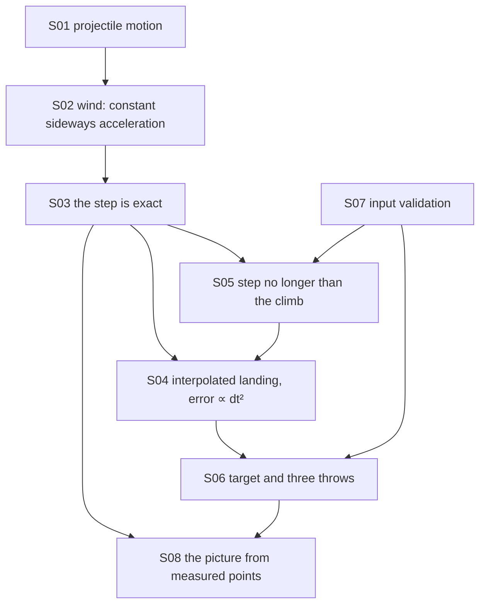

# Theory handbook

Why the program is correct, from the repository alone: every law, numerical rule and game rule the code relies on, each stated in Markdown **with a figure**, the place in the code that implements it, and the test or measurement that checks it.

- SI units; gravity 9.81 m/s²; the game's wind is +1.2 m/s² and its step 0.02 s.
- Plotted figures and the numbers quoted in the text are produced by the program's own functions: `make theory-figs` rewrites [figures/](figures/) and [figures/values.md](figures/values.md) (plain Julia, no packages). Diagrams are Mermaid, written in the pages.
- `make theory-check` fails when a statement has no figure, a link is broken, a referenced function or test no longer exists, or an exported function is missing from the table below.

## Pages

1. [The throw: projectile motion and how it is computed](01-projectile.md) — closed-form range, time and apex; the wind; the exact step; the interpolated landing and its error; the shortened step
2. [The game: target, turns, input and the screen](02-game.md) — the hit rule and the three throws, input validation, the character plot

## How the pieces depend on each other

## Coverage: statement → page → figure → code → test

| ID | Statement | Page | Figure | Code | Test |
|---|---|---|---|---|---|
| S01 | Range, time of flight and apex on flat ground | [1](01-projectile.md) | `figures/flight.svg` | `src/ArcLanding.jl#flight` | `test/runtests.jl#REQ-flight analytic range` |
| S02 | Wind as a constant horizontal acceleration | [1](01-projectile.md) | `figures/wind.svg` | `src/ArcLanding.jl#trajectory` | `test/runtests.jl#REQ-wind numeric integration and convergence` |
| S03 | The step is exact for constant acceleration | [1](01-projectile.md) | `figures/points.svg` | `src/ArcLanding.jl#trajectory` | `scripts/theory_figs.jl#points-on-path` |
| S04 | Linear interpolation of the landing; error of order dt² | [1](01-projectile.md) | `figures/landing-error.svg` | `src/ArcLanding.jl#fraction` | `test/runtests.jl#REQ-wind numeric integration and convergence`, `scripts/theory_figs.jl#landing-order` |
| S05 | The step is at most the time to the apex | [1](01-projectile.md) | mermaid | `src/ArcLanding.jl#dt = min(dt, vy / 9.81)` | `scripts/theory_figs.jl#shallow-points` |
| S06 | The target 28–32 m and the three throws | [2](02-game.md) | `figures/target.svg`, mermaid | `src/ArcLanding.jl#hit`, `src/ArcLanding.jl#shoot` | `test/runtests.jl#REQ-finish win, miss, freeze and input recovery` |
| S07 | Input validation | [2](02-game.md) | mermaid | `src/ArcLanding.jl#parameters`, `src/ArcLanding.jl#play` | `test/runtests.jl#REQ-input finite bounded parameters` |
| S08 | The picture is drawn from the measured points | [2](02-game.md) | mermaid | `src/ArcLanding.jl#plot`, `src/ArcLanding.jl#screen` | `test/runtests.jl#REQ-input trajectory bounds and target boundaries` |

Tests named `scripts/theory_figs.jl#…` are measurements recorded in [figures/values.md](figures/values.md) by `make theory-figs`, not assertions of `make test`. S03 and S05 are covered only that way.

## Reading the source against this table

Functions reviewed for this handbook: all of `src/ArcLanding.jl` — the exported `flight`, `trajectory`, `shoot`, `screen`, `play` and the internal `parameters`, `hit`, `plot` and the `Game` struct.

The program is unchanged by this handbook: it adds `scripts/theory_figs.jl`, `scripts/theory-check.py`, two Makefile targets and these pages.
